# Лабораторная работа 4. MLOps Вариант 18

**Вариант 18. Учебная классификация типа опухоли (Breast Cancer)**

## 1. Подготовка окружения
Начали с проверки системы (Ubuntu 24.04.4, Python 3.12.3, Docker 29.1.3). Установили плагин `docker-compose-v2`. Создали структуру проекта и виртуальное окружение, установили зависимости из `requirements.txt` (MLflow 3.5.0, scikit-learn 1.7.2 и др.).

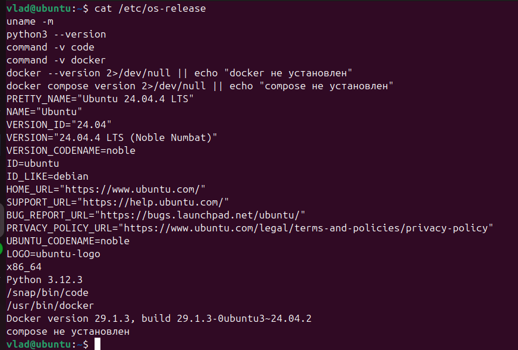
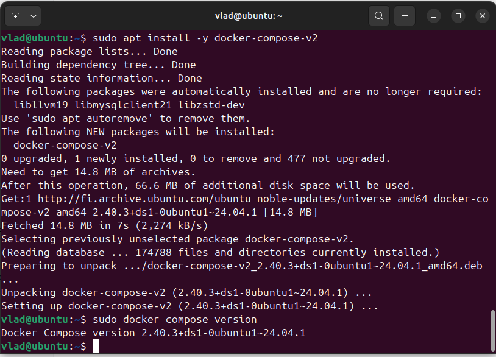
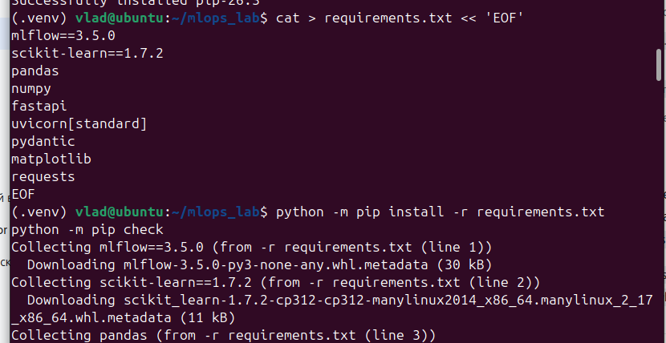
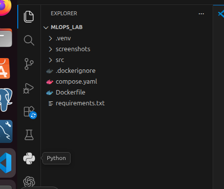

## 2. Запуск сервера MLflow
Запустили локальный сервер MLflow с хранением метаданных в SQLite и артефактов в локальной папке:

    mlflow server \
      --backend-store-uri sqlite:////home/vlad/mlops_lab/mlflow-data/mlflow.db \
      --artifacts-destination ./mlflow-data/artifacts \
      --serve-artifacts \
      --host 127.0.0.1 \
      --port 5000

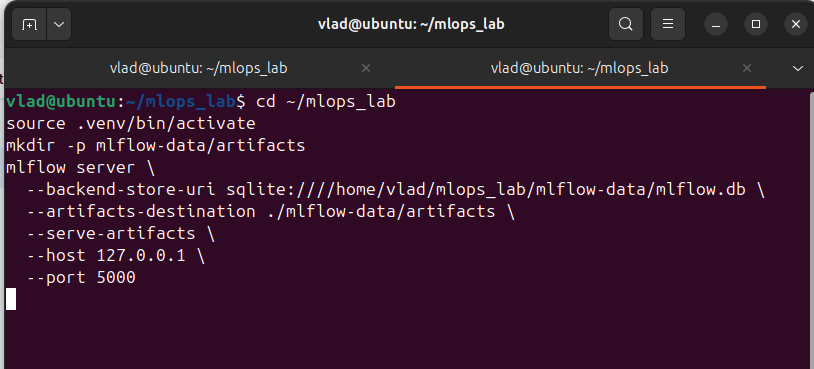
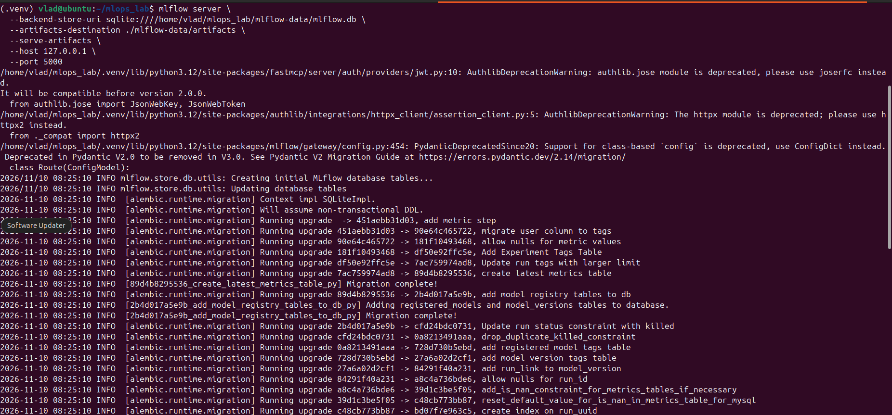

## 3. Проведение экспериментов
Провели 6 запусков с разными алгоритмами и гиперпараметрами. В качестве метрики для выбора использовался `val_f1_macro`.

| № | Алгоритм | Гиперпараметры | val_accuracy | val_f1_macro |
| :--- | :--- | :--- | :--- | :--- |
| 1 | LogisticRegression | C=0.1 | ~0.9737 | ~0.9715 |
| 2 | LogisticRegression | C=1 | **~0.9912** | **~0.9906** |
| 3 | LogisticRegression | C=10 | ~0.9649 | ~0.9626 |
| 4 | RandomForest | trees=50, depth=3 | ~0.9561 | ~0.9531 |
| 5 | RandomForest | trees=100, depth=5 | ~0.9474 | ~0.9439 |
| 6 | RandomForest | trees=200, depth=8 | ~0.9561 | ~0.9531 |

**Выбор чемпиона:** Лучший результат показала `LogisticRegression` с `C=1`. Ей был назначен alias `champion`, и она была экспортирована для деплоя (`export_model.py`).

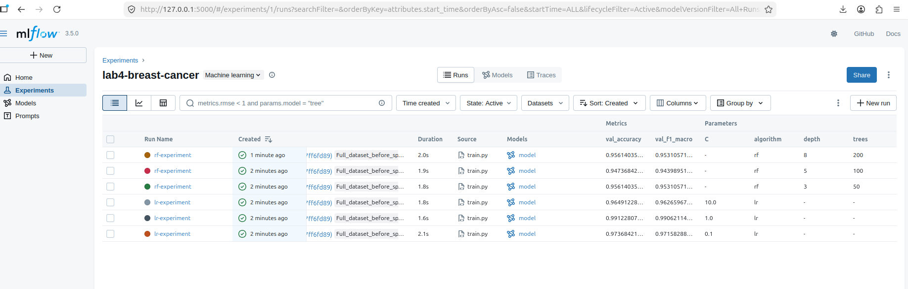

## 4. Сборка Docker-контейнера (Версия 1) и проверка API
Собрали образ `breast-api:v1` и запустили контейнер. Проверили работу API (health, metadata, predict). Также проверили обработку ошибок: неверный формат данных возвращает `422 Unprocessable Entity`.

    sudo docker build -t breast-api:v1 .
    sudo docker run -d --name breast-api -p 127.0.0.1:8000:8000 breast-api:v1

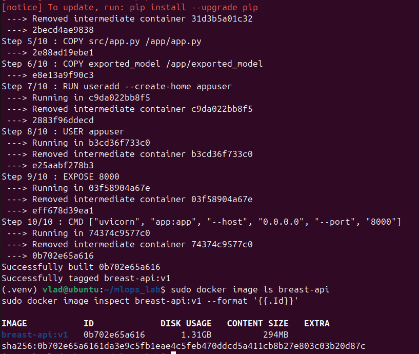
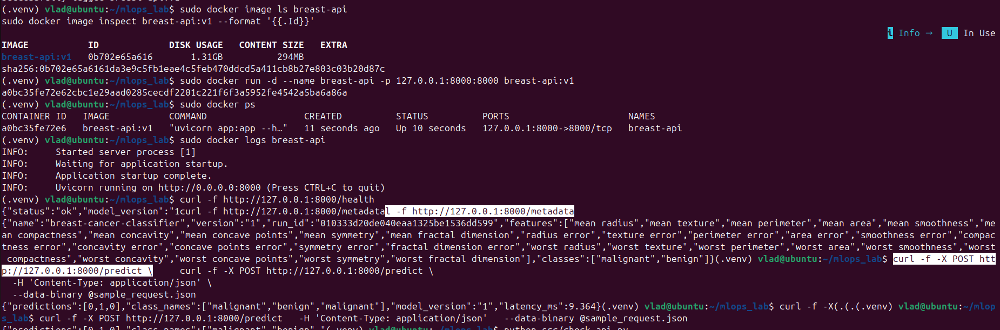
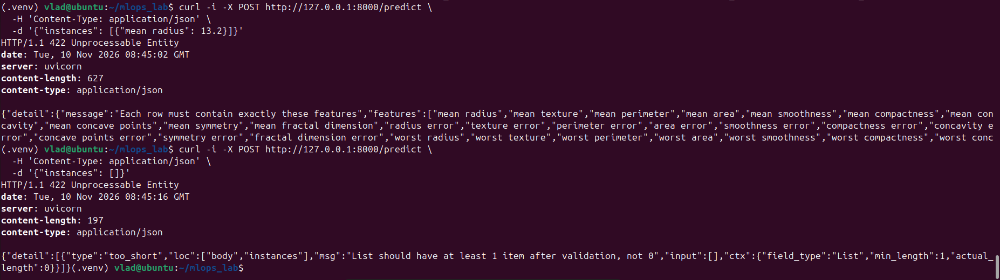
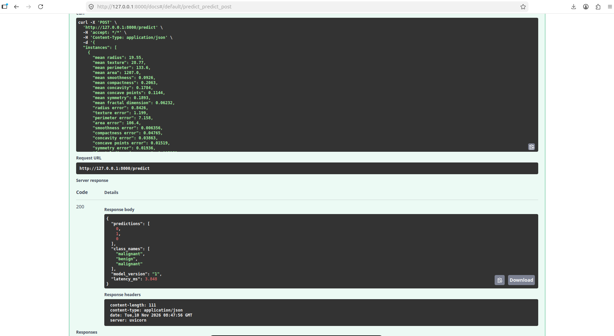

Смоук-тест `check_api.py` подтвердил, что контейнер выдает те же предсказания, что и экспортированная модель:

    python src/check_api.py

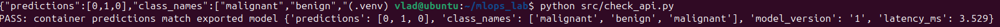

## 5. Демонстрация обновления и отката
Сымитировали выход новой версии. Переключили alias `champion` на версию 2 (RandomForest), пересобрали образ `breast-api:v2` и перезапустили контейнер.

Затем выполнили **откат**: остановили контейнер v2, запустили сохраненный образ `breast-api:v1` и вернули alias `champion` на первую версию.

    # Обновление
    python src/promote.py --version 2
    python src/export_model.py
    sudo docker build -t breast-api:v2 .
    sudo docker stop breast-api && sudo docker rm breast-api
    sudo docker run -d --name breast-api -p 127.0.0.1:8000:8000 breast-api:v2

    # Откат
    sudo docker stop breast-api && sudo docker rm breast-api
    sudo docker run -d --name breast-api -p 127.0.0.1:8000:8000 breast-api:v1
    python src/promote.py --version 1

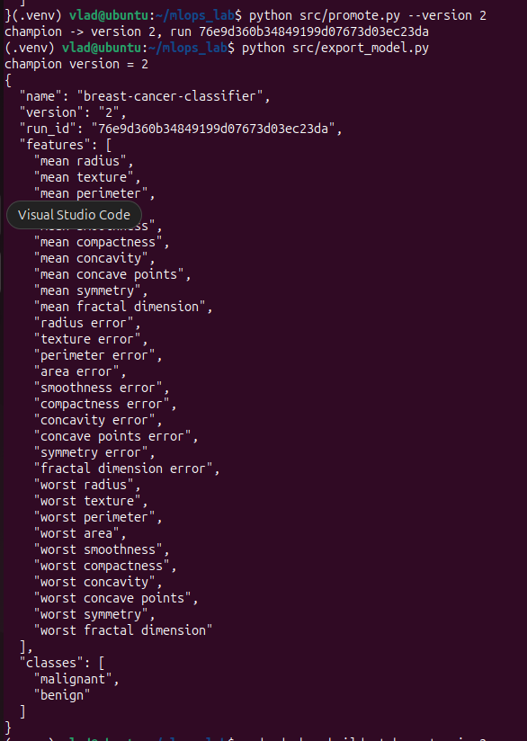
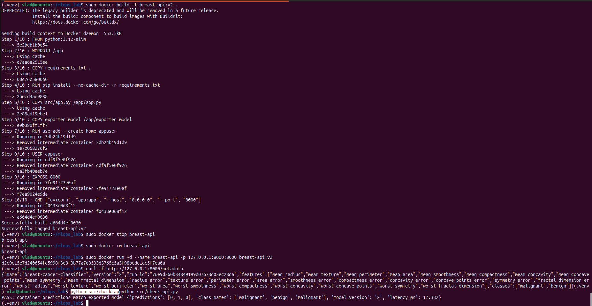
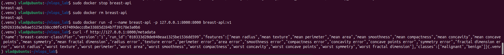

## 6. Запуск через Docker Compose
В финале остановили ручной контейнер и запустили сервис через `docker compose`. Настроен `healthcheck`, контейнер успешно перешел в статус `healthy`.

    sudo docker compose up -d --build
    sudo docker compose ps

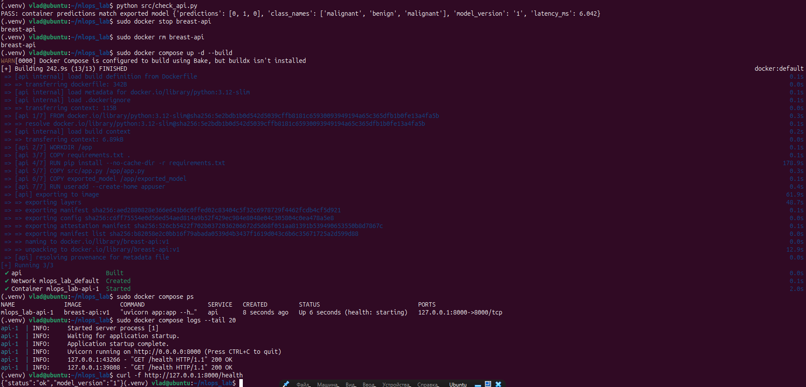

## 7. Итоговая оценка на тесте
После выбора лучшей модели (LogisticRegression, C=1) прогнали её на отложенной тестовой выборке (`evaluate.py`):
*   `test_accuracy`: **0.9824**
*   `test_f1_macro`: **0.9811**

## 8. Выводы
Прошли полный цикл MLOps. Развернули трекер экспериментов, обучили 6 моделей, выбрали лучшую по F1-метрике. Завернули модель в Docker-контейнер с FastAPI и протестировали API на корректные и ошибочные запросы. Продемонстрировали бесшовное обновление до v2 и откат на v1 с помощью тегов Docker-образов. Проверили стабильность работы через Docker Compose с настроенным healthcheck.
